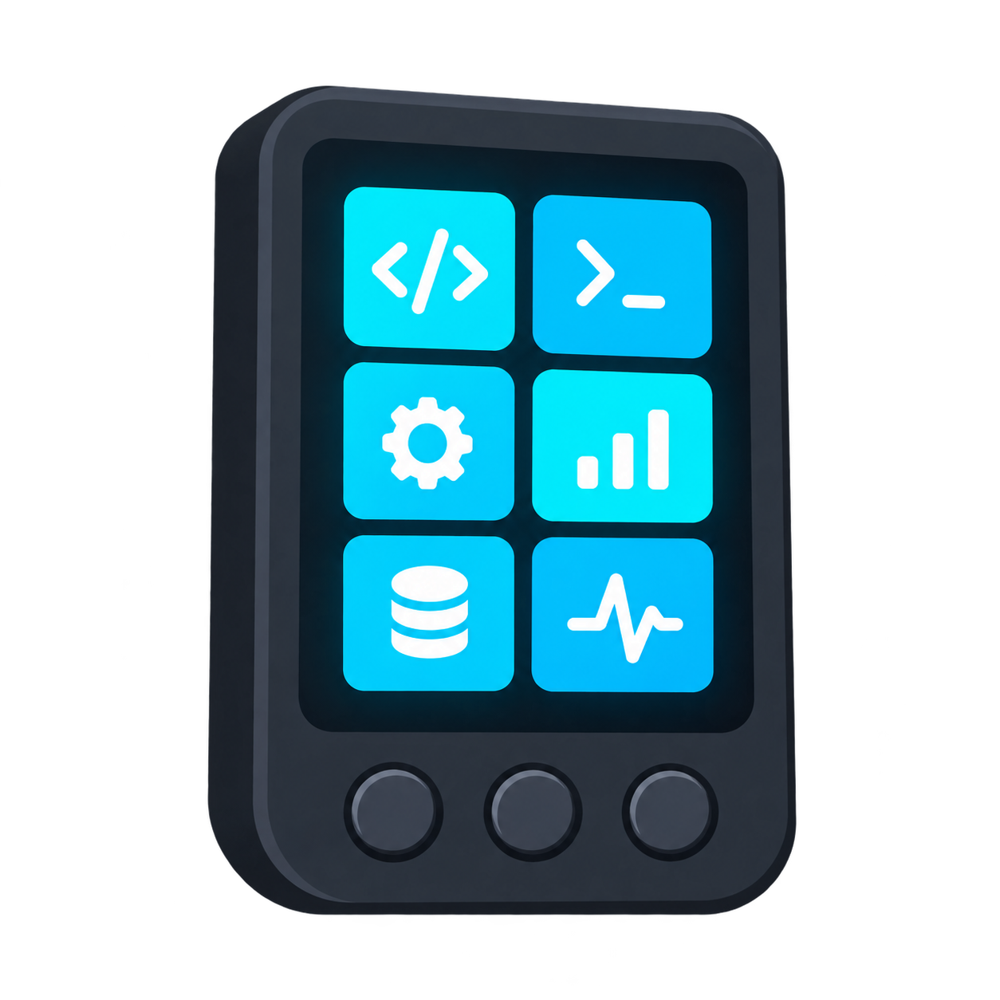

<p align="right"><a href="README.zh_CN.md">简体中文</a> · <strong>English</strong></p>
<p align="center"></p>
<h1 align="center">Codex Passport</h1>
<p align="center">A three-button Codex Micro control panel for FoloToy AI Passport.</p>
<p align="center"><strong>Native Codex Micro connection. No extra bridge app.</strong></p>

Codex Passport turns the FoloToy AI Passport into a portable BLE control panel for **ChatGPT Desktop's native Codex Micro feature**. Select agents, send commands and control the computer microphone with three physical buttons and a dedicated screen.

No custom Mac app, plugin, Wi-Fi connection, cloud relay or API key is required. **A compatible ChatGPT Desktop installation is still required.** This is an independent interoperability experiment, not an official OpenAI or Work Louder product, and not Codex CLI hardware pairing.

## Features

- Six Agent keys with host-synchronized status colors.
- Fast, Approve, Decline, Fork, Mic and Send controls; local confirmation for Approve/Decline.
- Four virtual joystick directions and dial rotation, click and hold.
- Three-page, non-touch interface with remembered focus and press/release timing.
- Local sidebar: screen off/wake, brightness, re-pairing and diagnostics.
- Encrypted BLE HID, bonding, automatic re-advertising and real battery readings.

**Mic controls the computer's microphone.** The Passport's built-in microphone does not stream audio to the computer. Charging state is reported as unknown where the BSP cannot measure it.

## Hardware and requirements

| Item | Requirement |
| --- | --- |
| Board | FoloToy AI Passport, ESP32-C3, 8 MB Flash, no PSRAM |
| Display | 240 × 320 portrait ST7789P3 |
| Input | UP, DOWN and OK on the existing ADC button ladder |
| Build | ESP-IDF 5.5.3, locked dependencies |
| Host | macOS with a compatible ChatGPT Desktop and Input Monitoring permission |

No wiring changes, touchscreen or external keyboard are needed.

## Controls

| Physical action | Result |
| --- | --- |
| UP / DOWN short press | Select previous / next item |
| UP / DOWN hold ≥500 ms | Previous / next page |
| OK press / release | Press / release the selected virtual control |
| Hold OK | Keep Mic or Dial Click pressed until release |
| Two quick OK clicks | Forward both clicks; the desktop decides double-click behavior |

Pages cycle through **AGENTS → COMMANDS → NAV / DIAL**. Each page remembers its selection. Approve/Decline require a second OK press within three seconds; navigation cancels confirmation.

Open **Settings**, the last cell on NAV / DIAL, to use the local sidebar. The first press after Screen Off only wakes the screen; it sends no remote action. Re-pair requires confirmation and also requires forgetting the old device on macOS.

See the [complete controls, protocol and troubleshooting guide](docs/codex-passport-guide.md).

## Build and test

Activate [ESP-IDF 5.5.3](docs/development/engineering/environment-setup.md), then run from this directory:

```bash
idf.py build
./tools/validate.sh
```

The complete gate checks the repository, host tests, actual LVGL rendering, firmware build, merged image and matching debug archive. For logic-only iteration:

```bash
./tools/validate.sh --static
```

The verified merged image is `build/FoloToy-AI-Passport-full.bin`. The upstream filename is retained for compatibility with the build tools. Matching debug symbols and a manifest are in `build/firmware/<full-image-sha256>/`.

Generated files in `build/`, `managed_components/` and `dist/` are not source and are not committed. Distribute firmware as release attachments, retaining its matching debug archive. Tests, dependency locks, build tools and hardware documentation are part of the source distribution.

## Flash and connect

Use a release's verified full image, or build it yourself. Flash the **merged image at `0x0`**, not the application-only binary. Replace `PORT` with the device's USB Serial/JTAG port:

```bash
python -m esptool --chip esp32c3 --port PORT --baud 460800 \
  write_flash --flash_mode dio --flash_size 8MB --flash_freq 80m \
  0x0 build/FoloToy-AI-Passport-full.bin
idf.py -p PORT monitor
```

A merged flash can reset stored settings and bonds. A full-chip erase is not required. Build and validation commands do not flash the device.

1. Pair **Codex Micro** in macOS Bluetooth settings, in a trusted environment.
2. Open ChatGPT Desktop and grant **Input Monitoring** permission.
3. Open **Settings → Codex Micro** and check device detection.
4. Check notification subscription and real button actions; Bluetooth connection alone is not application acceptance.

Pairing uses encrypted Secure Connections Just Works, without a verification code. The [acceptance checklist](docs/codex-passport-guide.md#macos-acceptance--all-devicedesktop-steps-pending) includes all controls, reconnects and diagnostics.

## Project layout

| Directory | Purpose |
| --- | --- |
| `main/codex_*` | Application, UI, input, local settings, BLE and protocol |
| `components/bsp/` | Shared board drivers |
| `tests/` | Host regression tests and test-only dependencies |
| `tools/` | Validation, firmware packaging and verification |
| `docs/` | User guide, validation record and upstream engineering references |
| `skills/` | Maintained development workflows |

Upstream demo sources remain as hardware references and regression fixtures; they are not the application entry point. No private desktop implementation or credentials are included.

## Compatibility and validation

**Build: PASS · Host tests: PASS · Repaired-firmware device tests: NOT RUN.**

Version 0.1.1 corrects an encrypted Just Works access mismatch and separates input readiness from host RPC detection. The regression is reproduced and tested against the pinned SDK's permission code. Real-device and desktop acceptance of the repaired image remains pending; see the [validation record](docs/codex-passport-validation.md).

The protocol is undocumented by its vendor, and desktop updates may change compatibility. Extra layers, OTA, multi-host channels, physical lighting and hardware microphone streaming are outside this version's scope.

## Contributing

Keep changes focused and run the relevant tests, then the complete validation gate. Retain paired English/Simplified Chinese documentation and never commit credentials, personal logs or build outputs. See [contribution guidelines](.github/CONTRIBUTING.md).

## License

[MIT](LICENSE). Original FoloToy copyright and third-party notices are retained. Test-only cJSON has its own [license notice](tests/vendor/cjson/README.md). Product names identify interoperability targets, not endorsement.

## Acknowledgments

- [FoloToy AI Passport](https://github.com/FoloToy/ai-passport) — hardware, BSP and ESP-IDF project foundation.
- [codex-micro-4-core2](https://github.com/imliubo/codex-micro-4-core2) — ESP32 transport reference.
- [freemicro](https://github.com/eliBenven/freemicro) — protocol and factory-default research.

Thanks to the [Linux DO community](https://linux.do) for sharing and discussion.
